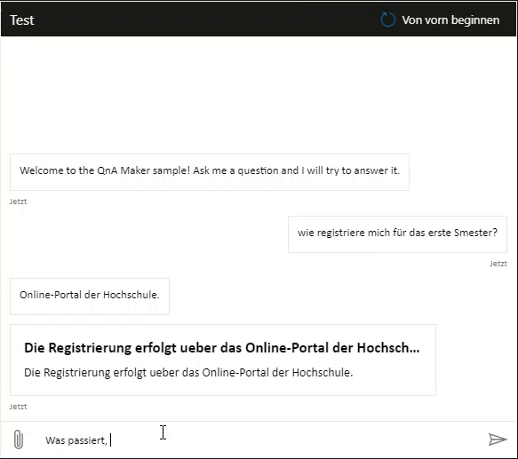
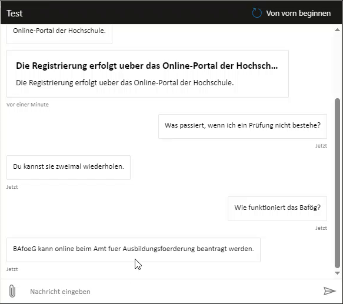

# 🎓 StudyBot – Hochschul-Chatbot mit Microsoft Azure

> **Studienprojekt im Modul WK1109 – Entwicklung betrieblicher Informationssysteme (EBI)**  
> Technische Hochschule Mittelhessen (THM) · Wirtschaftsinformatik · Sommersemester 2025  
> **Gruppenprojekt** · Portfolio-Dokumentation mit rekonstruierter Web-Chat-Oberfläche

## 🎯 Projektübersicht

**StudyBot** ist ein digitaler Assistent für eine fiktive Hochschule. Er soll häufige Fragen von Studierenden zu Einschreibung, Prüfungen, BAföG, Semesterorganisation und Campus-Services beantworten.

Im Projekt wurden ein **FAQ-Konzept mit zehn Fragen**, eine **Azure-basierte Architektur** und ein **Chatbot in einer Web-Chat-Testumgebung** dokumentiert. Die Vorführung zeigt, dass StudyBot Beispielanfragen beantworten konnte. Dieses Repository ergänzt die Projektdokumentation um eine **aus einem Screenshot rekonstruierte `index.html`** für Microsoft Bot Framework Web Chat.

> **Projektstatus:** Die Verbindung des ursprünglichen Chatbots wurde in der eingereichten Vorführung demonstriert. Die hier enthaltene `index.html` ist eine bereinigte Rekonstruktion des sichtbaren Codes – **kein Export der ursprünglichen vollständigen Anwendung**. Für den lokalen Betrieb ist weiterhin ein aktiver Azure-Bot mit Direct-Line-Zugang erforderlich. Anfrage-Logging und Reporting waren Teil der Aufgabenstellung bzw. Architekturplanung, sind durch die vorliegenden Materialien aber nicht als vollständig umgesetzt belegt.

## 🏗️ Architektur

**Nachgewiesene bzw. dokumentierte Komponenten:**

```text
Studierende im Browser
         │
         ▼
 Microsoft Bot Framework Web Chat
        (index.html)
         │
         │ Direct Line mit kurzlebigem Token
         ▼
 Azure Bot Service / StudyBot
         │
         ▼
 Statische FAQ-Antworten (Projektkonzept)
```

**Erweiterungen aus der Konzeptskizze – Implementierung nicht vollständig belegt:**

```text
 Azure Storage (Anfragelogs + Zeitstempel)
                  │
                  ▼
         Reporting / Analyse
```

In der ursprünglichen Konzeption werden zudem **Bot Framework SDK** sowie **Azure Language Studio / QnA** als mögliche bzw. teilweise vorbereitete Komponenten genannt. Diese Bausteine sind im Repository **nicht als fertiger Backend-Code enthalten**.

## 🛠️ Technologien

| Technologie | Verwendung im Projekt |
|---|---|
| Microsoft Azure | Cloud-Umgebung für die Bot-Ressourcen |
| Azure Bot Service | Registrierung und Verwaltung des Bots |
| Azure App Service | In der Dokumentation als Hosting-Ressource aufgeführt |
| Bot Framework Web Chat | Oberfläche zur Eingabe und Anzeige von Nachrichten |
| Direct Line | Verbindung zwischen Web-Chat und Bot |
| HTML, CSS, JavaScript | Rekonstruierte Web-Chat-Oberfläche in `index.html` |
| Node.js | **Zusätzlicher lokaler Beispielserver** zur sicheren Token-Ausgabe; nicht als Teil der ursprünglichen Abgabe nachgewiesen |
| FAQ-Wissensbasis | Zehn vorgegebene Fragen und Antworten im Projektkonzept |

## ✨ Funktionen und Ergebnisse

- ✅ Konzept für einen Studienassistenten mit **zehn FAQ-Fragen**
- ✅ Beispielantworten auf Fragen zu Einschreibung, Prüfungen und BAföG
- ✅ In einem Video dokumentierter Test des Chatbots über die Azure-Webchat-Oberfläche
- ✅ Web-Chat-Code mit `createStore`, `WEB_CHAT/SEND_EVENT` und `webchat/join` aus dem Screenshot nachvollzogen
- ✅ Anpassung der Chat-Oberfläche mit Bot-/Benutzerinitialen **SB** und **DU**
- 🔧 Sicherer, **zusätzlich erstellter** Beispiel-Endpunkt zur Ausgabe kurzlebiger Direct-Line-Tokens
- 📝 Protokollierung von Anfragen und Tagesreporting: **Anforderung / Planung**, keine bestätigte vollständige Umsetzung

## 🗃️ Wissensbasis (Beispiele)

| Frage | Beispielantwort aus dem Konzept |
|---|---|
| Wie registriere ich mich für das erste Semester? | Die Registrierung erfolgt über das Online-Portal der Hochschule. |
| Was passiert, wenn ich eine Prüfung nicht bestehe? | Du kannst sie zweimal wiederholen. |
| Wie funktioniert das BAföG? | BAföG kann online beim Amt für Ausbildungsförderung beantragt werden. |

Die vollständigen **zehn Konzeptfragen** stehen in [`data/sample-faqs.json`](data/sample-faqs.json). Diese Datei ist **ein Dokumentationsbeispiel**: Das Frontend lädt sie nicht automatisch als Bot-Antwortquelle. Alle Antworten gelten für die fiktive Projekthochschule und sind keine verbindliche Auskunft.

## 🚀 Entwicklungsschritte

1. **Konzeption** – Zielgruppe, Anwendungsszenario und typische Studienfragen festlegen.
2. **Azure-Ressourcen** – Ressourcengruppe, Azure Bot Service und App Service in der Projektdokumentation anlegen bzw. beschreiben.
3. **FAQ-Konzept** – Zehn Frage-Antwort-Paare für die Studienberatung vorbereiten.
4. **Chatbot-Demo** – Fragen im Azure-Webchat testen und im Video dokumentieren.
5. **Frontend nachvollziehen** – den im bereitgestellten Screenshot sichtbaren Web-Chat-Code in einer bereinigten HTML-Datei rekonstruieren.
6. **Geheimnisse schützen** – Direct-Line-Schlüssel nicht im Browser einbauen, sondern einen lokalen Token-Endpunkt als sichere Beispiel-Architektur ergänzen.

## 💻 Code: Web Chat (`index.html`)

Der Web-Chat-Code im Repository basiert auf dem Screenshot des ursprünglichen `index.html`-Ausschnitts. Enthalten sind insbesondere `styleOptions`, `createStore`, die Reaktion auf `DIRECT_LINE/CONNECT_FULFILLED` und das Ereignis `webchat/join` mit Sprache `de-DE`.

**Sicherheitsanpassung:** Im Screenshot steht ein Direct-Line-**Secret** direkt im JavaScript. Stattdessen bezieht diese Beispielimplementierung zur Laufzeit einen **kurzlebigen Token** über `/api/directline-token`. Der Server behält das Secret in einer lokalen, nicht versionierten `.env`-Datei.

**Änderung gegenüber dem Screenshot:** Die Begrüßung wird als Hinweis im Frontend angezeigt und als `webchat/join`-Ereignis an den Bot geschickt. Eine künstliche Bot-Nachricht wird nicht als Benutzer-Nachricht versendet.

### Lokaler Test (optional)

Voraussetzung: **Node.js 20.6+** sowie ein eigener aktiver Azure-Bot, dessen Direct-Line-Zugriff funktioniert.

```bash
# 1. Im entpackten Repository
cp .env.example .env
# 2. In .env nur lokal den eigenen Direct-Line-Schlüssel eintragen
# 3. Lokalen Server starten
npm start
```

Unter Windows kannst du `.env.example` im Explorer kopieren und die Kopie in `.env` umbenennen. Öffne anschließend `http://localhost:3000`.

Ohne gültigen Bot-Zugang zeigt das Frontend eine verständliche Fehlermeldung. **Der im Screenshot sichtbare Schlüssel wurde bewusst nicht übernommen.** Der Beispielserver ist für eine lokale Demonstration gedacht; vor einem öffentlichen Deployment wären u. a. Zugriffsschutz, Rate Limits und weitere Härtung notwendig.

Mehr dazu: [docs/setup.md](docs/setup.md) · [docs/security.md](docs/security.md)

## 📸 Screenshots

### Beispiel 1: Frage zur Einschreibung



### Beispiel 2: Prüfungen und BAföG



Die Bilder stammen aus der dokumentierten Chatbot-Vorführung. Vor einer Veröffentlichung sollten Projektgruppe und Hochschule der Nutzung der Materialien zugestimmt haben.

## 📁 Repository-Struktur

```text
studybot-ebi-github/
├── README.md
├── README_EN.md
├── index.html                 # Rekonstruierte Web-Chat-Oberfläche
├── server.mjs                 # Zusätzlicher lokaler Token-Server
├── package.json
├── .env.example               # Nur Platzhalter – kein echter Schlüssel
├── .gitignore
├── screenshots/
│   ├── studybot-einschreibung.png
│   └── studybot-pruefung-bafoeg.png
├── data/
│   └── sample-faqs.json      # Konzeptfragen, nicht angebundener Backend-Speicher
└── docs/
    ├── StudyBot_Projektdokumentation_anonymisiert.pdf
    ├── implementation-notes.md
    ├── security.md
    └── setup.md
```

## 📚 Dokumentation

- [Anonymisierte Projektdokumentation](docs/StudyBot_Projektdokumentation_anonymisiert.pdf)
- [Implementierungsstand und Quellen](docs/implementation-notes.md)
- [Sicherheit und Veröffentlichung](docs/security.md)

## 👥 Projektkontext

Studienprojekt als **Gruppenarbeit** im Modul *Entwicklung betrieblicher Informationssysteme*, Technische Hochschule Mittelhessen (THM), Sommersemester 2025. Die Beschreibung unterscheidet bewusst zwischen dokumentierten Ergebnissen und später ergänztem Beispielcode.
