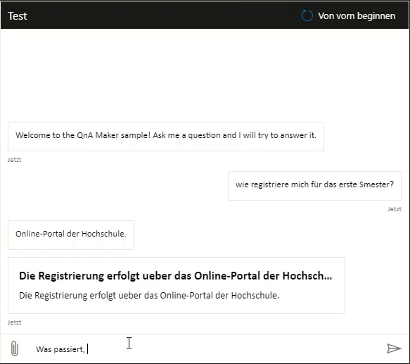
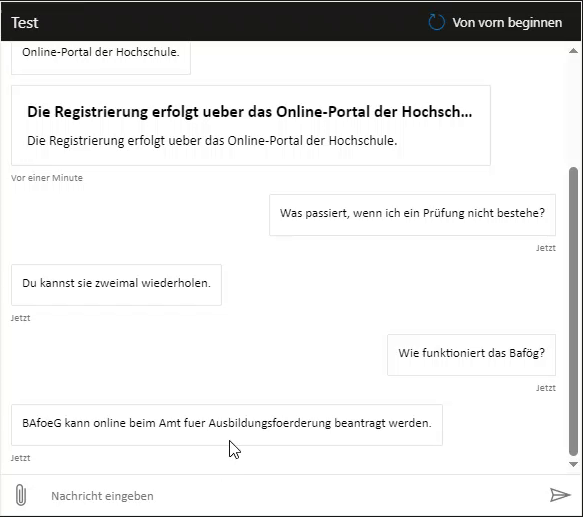

# 🎓 StudyBot – University Chatbot with Microsoft Azure

> **Academic group project**, Business Information Systems Development (EBI), Technische Hochschule Mittelhessen (THM), Summer 2025.

StudyBot is a FAQ chatbot designed to answer common student questions concerning enrollment, exams, financial aid, and campus services. The submitted documentation describes an Azure Bot Service configuration, a conceptual knowledge base of ten questions, and a video demonstration of answers inside Azure Web Chat.

## 🎯 Project scope

- Design a chatbot for a fictional university.
- Prepare ten FAQ question-answer pairs.
- Demonstrate chatbot replies through the Azure Web Chat test interface.
- Outline a potential architecture for storing and reporting questions.

**Evidence distinction:** The supplied documents and video demonstrate a working chatbot test, but do not confirm a complete independent backend source tree or a fully implemented analytics pipeline. The `index.html` in this repository is a **sanitized reconstruction of code visible in a screenshot**, not a claim that the original deployed website's full source was retrieved.

## 🏗️ Architecture

```text
Browser / Bot Framework Web Chat
               │
     Direct Line (short-lived token)
               │
        Azure Bot Service
               │
      FAQ answers (concept)
```

Planned/optional components in the project materials include Azure Storage and reporting tools. Their end-to-end implementation is not verified by the supplied files.

## 🛠️ Technologies

| Tool | Purpose |
|---|---|
| Microsoft Azure / Azure Bot Service | Cloud bot resources |
| Azure App Service | Hosting resource referenced in documentation |
| Bot Framework Web Chat | Chat interface |
| Direct Line | Browser-to-bot communication |
| HTML, CSS, JavaScript | Reconstructed web chat page |
| Node.js | Added **local example** server for minting short-lived tokens; not part of documented original implementation |

## ✨ Screenshots

**Enrollment question**



**Exams and BAföG**



## 💻 Source code and security

- `index.html`: Web Chat page reconstructed from the supplied screenshot, including `createStore`, connection event handling and `webchat/join`.
- `server.mjs`: additional minimal **local-only** token endpoint.
- `.env.example`: placeholder; **never commit the real Direct Line secret**.
- `data/sample-faqs.json`: conceptual questions; **not a running backend**.

To run locally, use Node.js 20.6+, copy `.env.example` to `.env`, set your own active Direct Line secret privately, then run `npm start`. See [docs/setup.md](docs/setup.md).

## 📁 Repository layout

```text
README.md · README_EN.md · index.html · server.mjs · package.json
screenshots/ · data/ · docs/ · .env.example · .gitignore
```

## 📄 Documentation

- [Anonymized project report (German)](docs/StudyBot_Projektdokumentation_anonymisiert.pdf)
- [Implementation and evidence notes](docs/implementation-notes.md)
- [Security notes](docs/security.md)

*Student group project, Summer 2025. The example code is separate from the originally documented Azure bot deployment.*
